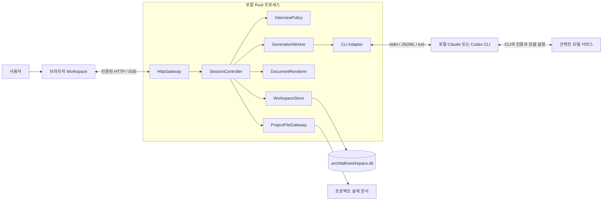

# ArchiTalk TO-BE 시스템 설계

작성일: 2026-11-17 · 상태: 구현 전 설계 제안 · 대상: 신규 Rust CLI 및 로컬 웹 UI

ArchiTalk는 **프로젝트 폴더에서 실행해, 대화로 요구사항과 아키텍처를 구체화하고 그 폴더에 설계 문서를 남기는 도구**다. 로컬에 설치된 Claude Code 또는 Codex CLI를 호출한다. 사용자는 규모·분야·요구를 한 번에 정리하지 않아도 된다. 도구는 현재까지의 이해와 중요한 미결정을 보여 주면서 다음 질문을 고른다.

이 문서는 ArchiTalk 자체의 목표 설계다. 이 도구가 나중에 사용자 프로젝트에 생성하는 문서의 구조와 구분한다. 제품 코드·실제 모델 호출·성능 검증은 이번 작업 범위가 아니다.

## 1. 설계 범위와 기준

### 확인된 요구와 현재 상태

| 구분 | 내용 |
| --- | --- |
| 사용자 확정 요구 | Rust로 구현하는 CLI, 실행한 프로젝트 폴더 기준 동작, 브라우저의 챗봇 UI, 단계적인 규모·분야·요구사항 정리, 자연스러운 이름의 로컬 문서 저장 |
| 추가 확정 요구 | 로컬 설치 `claude`·`codex`를 설정으로 호출. 모델과 생각 수준도 설정에서 선택 |
| 참고 대상 | `tools.camp`의 `cli/mdview`: cwd 기반 실행, 웹 UI 자동 열기, 단일 실행 프로세스 |
| 현재 저장소 | 소개 README·라이선스만 있는 신규 프로젝트. 이전 데이터 이전이나 기존 API 호환 대상 없음 |
| 설계 제안 | 단일 Rust 프로세스, 포함된 정적 UI, SQLite 상태 저장, CLI별 adapter, 구조화된 설계 상태와 Markdown 출력 분리 |
| 초기 지원 가정 | macOS·Linux의 로컬 디스크. Windows는 프로세스 트리 종료·파일 게시 검증 후 추가. 한국어 기본, 원문 언어 보존 |

CLI 실행은 로컬이지만 모델 추론까지 로컬이라는 뜻은 아니다. 실제 네트워크·인증·이용 조건은 선택한 CLI와 모델 설정을 따른다. ArchiTalk가 별도의 모델 API key를 요구하거나 CLI 인증 파일을 복사하지 않는다.

### 요구사항과 관찰 가능한 성공 기준

| ID | 요구 | 성공 기준 | 설계 대응 |
| --- | --- | --- | --- |
| FR-01 | 프로젝트에서 바로 실행 | `architalk` 실행 시 root 고정, 로컬 URL 출력, 브라우저 열기. 실패 시 URL 수동 사용 | §4, N01 |
| FR-02 | 차근차근 인터뷰 | 기본 한 턴 한 질문. 이미 확인한 내용 재질문 방지. 모름·추천·보류·수정 지원 | §3, N02 |
| FR-03 | 규모·분야·위험 반영 | 작은 도구와 복잡한 시스템의 주제 깊이가 달라지고, 작은 고위험 주제도 검토 | §3.2 |
| FR-04 | 설계의 근거 보존 | 사용자 진술·파일 관찰·가정·모델 제안·사용자 결정 구분 및 출처 추적 | §5 |
| FR-05 | 제안·비판·검토 | 중요한 선택의 대안·비용·위험과 검토 지적 처리 결과가 문서에 연결 | §3.4, §8 |
| FR-06 | 문서 저장 | 읽을 수 있는 프로젝트명·주제명 제안, 상대 경로 미리보기, 초안 저장과 검토본 저장 구분 | §7, N04~N05 |
| FR-07 | 중단·재개 | 마지막 저장된 대화·확정 상태 복원, 미완료 생성 표시, 자동 유료 재실행 없음 | §5~§6, N07 |
| FR-08 | 로컬 AI CLI 선택 | Claude print / Codex exec adapter 선택, 설치·버전 진단, 실패 복구 안내 | §4.3, N06~N08 |
| FR-09 | 모델·생각 수준 설정 | 기본값과 역할별 override, 다음 run 적용, 실행에 사용한 설정 스냅샷 보존 | §4.4, N08 |
| FR-10 | 기존 프로젝트 활용 | 제한된 읽기 전용 자료 탐색, 전달할 파일·범위 확인, 변경 시 관련 근거 재검토 | §3.1, §9 |
| QR-01 | 문서 보호 | 이름 충돌·외부 편집·경로 이탈 시 원본을 보존하고 명시적 복구 경로 제공 | §7 |
| QR-02 | 일관성 | 중복 명령·다중 탭·늦은 CLI 응답이 대화·문서를 중복 확정하거나 덮어쓰지 않음 | §5~§6 |
| QR-03 | 배포 간결성 | 사용자는 Rust 바이너리와 선택한 AI CLI만 준비. Node·별도 웹 서버 불필요 | §4 |
| QR-04 | 실행 경계 | shell 문자열 조합 금지, CLI 실행·출력·취소 상한, 로컬 HTTP 인증 및 렌더링 방어 | §4.3, §9 |

MVP 제외: 소스 코드 생성·수정·빌드 실행, 원격 공동 편집, 웹 서비스 호스팅, 자동 로그인·CLI 설치·업데이트, 임의 에이전트 플러그인 실행, 전체 저장소 무제한 수집, 모든 모델/CLI 버전 호환. 외부 웹 리서치 자동화도 후속이며 v1은 사용자가 제공한 자료와 제한된 프로젝트 맥락을 사용한다.

## 2. 제품 흐름과 문서 경험

```text
cd <project>
architalk                       # 현재 폴더, 기존 세션이 있으면 선택해 이어가기
architalk --no-open              # 브라우저 자동 실행 생략, URL 출력
architalk --project <directory>  # 명시적으로 다른 root 선택
architalk doctor                # 설치/버전/옵션 진단. 모델 호출·로그인 변경 없음
```

위 명령은 제안하는 ArchiTalk 계약이며 아직 구현되지 않았다. 설정이 없으면 웹 안에서 AI CLI 선택부터 안내한다. 설정이 없어도 로컬 문서와 저장된 대화는 볼 수 있다.

1. 실행 폴더 이름과 발견한 문서를 보여 주고, 어떤 자료를 읽고 AI 입력에 포함할지 선택한다.
2. “무엇을 만들고, 누가 어떤 일을 하게 되나요?”에서 시작한다. 입력에 이미 답이 있으면 다음 중요한 빈칸으로 이동한다.
3. 대화 3~5개마다 현재 이해·가정·남은 중요한 질문을 짧게 요약한다. 이는 라운드 예산이며 완료 기준이 아니다.
4. 사용자는 언제든 현재 초안, 근거, 결정과 미결정 항목을 열 수 있다. 초안을 보려면 인터뷰를 끝낼 필요가 없다.
5. 중요한 기술 선택에는 기본적으로 2~3개의 현실적 대안을 비교한다. 답이 명백한 작은 선택에 억지 대안을 만들지 않는다.
6. 검토 역할이 반례를 제시하고 작성 역할이 수정한다. 사용자만 답할 수 있는 질문을 압축해 다시 묻는다.
7. 문서 이름·변경 내용·남은 가정을 보여 준 뒤 저장한다. 내용 수락과 디스크 저장 성공은 별개다.

예: “회사 내부 20명이 쓰는 회원 알림 서비스”라면 처음부터 분산 큐를 권하지 않는다. 알림 지연 허용, 중복 발송, 외부 발송사의 실패, 개인정보 범위부터 확인하고 단일 프로세스·작업 큐 등의 대안을 설명한다. “하루 천만 건”은 측정값인지 희망값인지 구분한다.

화면은 `/`의 단일 Workspace다. 인터뷰·생성·검토·저장·복구·설정은 이 화면의 장면이다. 상세는 [화면 이동](navigation.md), [화면 배치](screen-layout.md), [직접 여는 화면 모형](details/screens/workspace.html)에 있다. fragment는 모형의 장면 확인용이며 제품 라우트가 아니다.

## 3. 적응형 인터뷰와 설계 방법

### 3.1 단계와 질문 선택

단계는 `문맥 확인 → 목적·경계 → 요구·시나리오 → 대안·결정 → 검토 → 문서 반영`이다. 답변이 이전 결정을 바꾸면 관련 부분으로 돌아갈 수 있다. 고정 단계 수·고정 질문 수를 모두 채우게 하지 않는다.

진행 엔진은 다음 순서로 동작한다.

1. 읽기 범위 안의 파일과 기존 대화에서 이미 답한 항목을 찾는다. 설치된 기술이 있다는 사실을 그 기술의 채택 의사로 해석하지 않는다.
2. 모델은 답변을 `CandidatePatch`와 질문 후보로 제안한다. patch에는 근거, 대상 ID, 추가/대체/보류가 들어간다.
3. 코드가 스키마·참조·revision·허용 전이·직접 명령과의 모순을 검사한다. 의미적 정확성을 완전히 판별한다고 주장하지 않는다.
4. 질문 후보를 **상충하는 요구 → 되돌리기 어려운 고위험 결정 → 핵심 시나리오/계약 → 나머지 중요한 빈칸** 순으로 고른다. 동순위는 선행조건·질문 비용·안정 ID로 정렬한다.
5. 모델은 선택된 질문을 자연어로 표현한다. 선택지, 자유 입력, “모름”, “추천해 주세요”, “보류”를 제공한다. 중요하지 않은 문체 선호를 묻지 않는다.

`QuestionCandidate`의 필드는 `id, target_ref, reason, evidence_refs, priority_class, depends_on, expected_resolution, status`다. LLM이 만든 확신도나 종합 점수로 완료를 결정하지 않는다. 스키마 오류는 최대 1회 repair run 후 실패로 남기며, 무한 자기수정 호출을 하지 않는다.

| 사용자 입력 | 상태에 반영하는 방식 |
| --- | --- |
| 명확한 사실·제약 | 원문 메시지를 출처로 사용자 진술 기록 |
| 모름 | unknown + 확인 방법. 트래픽/SLA 숫자를 지어내지 않음 |
| 추천 요청 | 제안된 결정 또는 가정. 이후 모든 결정의 포괄 승인으로 확대하지 않음 |
| 보류 | 영향·차단 여부·담당·다시 확인할 조건 기록 |
| 이전 답변 수정 | 이전 항목 superseded, 영향받는 요구/결정/검토를 stale 처리 |

### 3.2 규모·위험·분야를 따로 판단

| 축 | 확인할 신호 | 반영 |
| --- | --- | --- |
| 설계 규모 | 독립 배포·팀·외부 연동·데이터 저장·실시간 처리·운영 환경·이전 범위 | 문서 분할과 상세 계약의 필요성 |
| 실패 영향 | 데이터/금전 손실, 민감 정보, 공개 노출, 복구 어려움, 안전 영향 | 필수 실패 시나리오와 검토 깊이 |
| 분야·환경 | SaaS/업무/데스크톱/AI/장치/폐쇄망, 현업 용어·규칙 | 질문 overlay와 필요한 근거 |

문서 깊이는 `간략 / 기본 / 상세`이며 주제별로 다를 수 있다. 기본은 한 문서다. 작은 고위험 시스템은 범위는 짧아도 복구·권한을 깊게 다룬다. 큰 프로젝트도 모든 절을 길게 만들지 않는다. 규모 추천과 이유를 보여 주고 사용자가 조정할 수 있게 한다.

분야 pack은 `id, version, applicability_rules, glossary, coverage_items, question_templates, required_scenarios, review_checks`인 선언형 자료다. 기본 pack에 데이터·실시간·AI·결제 등의 overlay를 더한다. 알 수 없는 적용 조건은 false가 아닌 unknown이다. pack은 shell 명령이나 추가 파일 권한을 부여하지 않는다. 업종 이름만으로 법규·업무 규칙을 확정하지 않는다.

`CoverageItem.status`는 `unknown / covered / deferred / not_applicable`다. `required`, `blocker`, `assessment_source`(pack/사용자/검토자/모델 제안), `assessment_status`(제안/확인/상충), 적용 조건과 근거를 별도 보관한다. 모델 제안만으로 필수 여부를 해제하지 않는다. 숫자 진행률 대신 “핵심 흐름 정리됨 · 복구 목표 확인 필요”처럼 현재 상태를 보여 준다.

| 필수 항목의 상태 | 검토 준비 게이트 |
| --- | --- |
| covered + 필요한 근거/시나리오 유효 | 통과 |
| unknown 또는 적용 조건 unknown | 미통과. 중요 위험의 적용 여부부터 확인 |
| deferred + blocker=true | 미통과. 초안 저장은 가능 |
| deferred + blocker=false | 담당·영향·검증 시점과 확인된 분류가 있으면 통과 가능 |
| not_applicable | 확인된 제외 근거가 있어야 통과. 모델 단독 제외는 미통과 |

필수/차단 여부는 기본 pack의 검토 규칙과 명확한 사용자 제약에서 시작하고, 판단이 상충하거나 의미 해석이 필요하면 확인 대상으로 남긴다. 기계 규칙이나 검토 모델이 위험을 빠짐없이 찾는다는 뜻은 아니다.

### 3.3 문서 구조와 추적

기본 문서는 목적·사용자, 범위/제외, 주요 요구와 수락 조건, 시스템 경계, 구성·데이터·주요 흐름, 품질·실패·운영, 중요한 결정, 위험/미결정, 구현·검증 계획으로 구성한다. arc42의 관점을 참고하되 원본 템플릿을 전부 복제하지 않는다.

추적은 `근거 → 요구 → 결정 → 구성요소/계약 → 시나리오/검증 계획 → 문서 절`이다. 요구마다 과도한 별도 문서를 만들지 않는다. 기본 문서의 표와 안정 ID로 시작하고 독립 관리 가치가 생길 때만 상세 계약·ADR을 분리한다. 구조 그림은 맥락·컨테이너부터 시작하며 C4의 네 단계를 모두 그리지 않는다. [C4 공식 설명](https://c4model.com/diagrams)

MADR의 중요한 결정·대안·근거·결과 구성을 참고한다. 선택하지 않은 대안, 비용, 되돌릴 조건도 남긴다. [MADR](https://adr.github.io/madr/)

### 3.4 제안·비판·개선 루프

제품의 “역할”은 별도 로컬 CLI 호출에 전달하는 작업 맥락이다. CLI 자체의 자율 하위 에이전트 기능에 의존하지 않는다. 사용자에게는 하나의 설계 파트너로 보인다.

| 역할 | 입력/출력 | 권한 |
| --- | --- | --- |
| 대화 | 현재 상태·선택된 질문 → 답변 해석/질문 표현 | patch 제안만 |
| 설계 작성 | immutable snapshot → 대안·구조·문서 후보 | 상태·파일 직접 변경 불가 |
| 비판 검토 | 같은 요구·후보·근거 → finding 목록 | 결함 제안만, 원본 수정 불가 |
| 추가 전문 검토 | 위험 주제에 한정한 snapshot → 운영/데이터 등의 반례 | 선택적으로 실행 |

`Finding = id, severity, affected_refs, evidence, impact, proposed_resolution, disposition`이다. `수용 / 기각+근거 / 보류+영향`으로 처리하고 중복 지적을 합친다. 최초 검토 1회 후 수정된 범위 재검토를 최대 2회 수행하는 기본 예산을 둔다. 필수 지적이 남으면 예산 소진을 완료로 바꾸지 않고 미검토/미해결로 표시한다. 정상 편집 선택마다 사용자 승인을 요구하지 않는다.

MVP는 프로젝트당 CLI 자식 프로세스 한 개만 실행한다. 역할은 순차 실행하며 API를 안정시킨 뒤 독립 전문 검토 병렬화를 고려한다. 같은 모델의 역할 분리는 독립 관점의 시도이지 정답 보장이나 다수결 근거가 아니다. 사용자 설정으로 Claude와 Codex를 작성/검토에 나눠 쓸 수 있다.

### 3.5 내용 상태와 저장 상태

내용은 `draft → ready_for_review → approved`다. 수정된 revision은 다시 draft 또는 ready_for_review가 되고, 이전 승인은 이전 revision에만 남는다. `export_status`는 별도로 `not_exported / preparing / applying / completed / conflict / failed`를 갖는다. 따라서 **초안도 언제든 저장**할 수 있고, 저장 성공이 내용 승인을 뜻하지 않는다. 기본 저장은 “초안으로 저장”이며, 준비 조건을 통과했을 때만 “검토본으로 확정하고 저장”을 제공한다.

Draft는 `input_revision`(source design_revision), `document_hash`, `generated_at`을 갖고 `미생성 / 생성 중 / 현재 설계 버전 / 이전 설계 버전 / 생성 실패`를 구분한다. “초안 보기”는 마지막 완성 초안을 열며 미생성이면 생성 안내를 보여 준다. 새 답변이 있으면 이전 설계 버전임을 표시하고 새로 생성하는 동작을 제공한다. 이전 초안도 그 버전을 표시해 저장할 수 있지만 현재 설계의 승인으로 수락할 수 없다.

검토 준비 조건은 적용되는 필수 항목의 근거/명시적 보류, 핵심 요구 추적, 알려진 차단 모순 처리, 필수 finding 처리, 검토 범위 표시다. 치명적 미결정을 단순 보류로 숨기면 준비 상태가 될 수 없다. “검토본으로 확정하고 저장”은 현재 revision 수락과 출력 요청을 함께 처리할 수 있다. 구조 검사를 통과해도 실제 구현 가능성·의미적 정확성은 별도 검증 대상이다.

## 4. 목표 실행 구조



배포 단위는 Rust 바이너리 하나다. 브라우저는 외부 실행 환경, AI CLI는 외부 프로세스다. 별도 백엔드 서비스·브로커·웹소켓 서버를 추가하지 않는다. [매크로 흐름](details/job-flow/macro.md)과 [로컬 서비스 내부 흐름](details/job-flow/architalk.md)에 정상·실패·복구 사건을 나눴다. 내부 서비스가 하나이므로 `details/job-flow/system.md`는 생략한다.

### 4.1 모듈 책임과 공개 경계

| 모듈 | 공개 입력 → 결과 | 소유권·핵심 보장 |
| --- | --- | --- |
| Runtime | CLI/config → root handle, lock, listener, lifecycle | root와 프로세스 토큰. 잠금·종료·자식 supervisor 생성 |
| HttpGateway | 인증 DTO → command/query, receipt/snapshot/SSE | DB·파일 직접 쓰기 없음. Host/Origin/토큰·입력 크기 검증 |
| SessionController | revision 포함 command → receipt/run/event | 세션 상태의 유일한 writer. 긴 CLI 대기 동안 DB transaction 유지 안 함 |
| InterviewPolicy | 상태·candidate → 검증 결과/질문/coverage | 순수 정책. 외부 SDK·프로세스·DB 없음 |
| GenerationWorker | frozen context/settings → candidate/finding/error | 실행 조율. DB와 최종 문서 쓰기 없음 |
| CLI Adapter | RunSpec → normalized event/terminal result | executable/argv·입출력 parser·취소·버전별 capability 소유 |
| DocumentRenderer | 검토된 model → 상대 파일명 제안/정확한 bytes/hash | 결정적 rendering. 임의 모델 경로를 실행하지 않음 |
| WorkspaceStore | transaction/query → commit/snapshot | SQLite 스키마·migration·receipt·state·run·export intent |
| ProjectFileGateway | ScanPlan/ExportPlan → evidence/write result/conflict | root 상대 디렉터리 연산과 hash 검사. DB 변경은 controller에 반환 |

CLI adapter는 `CliRunner` trait의 ClaudePrint/CodexExec 구현이며 하나의 큰 공통 명령 템플릿으로 두 도구의 차이를 숨기지 않는다. 순수 모델 DTO에 CLI의 원시 JSON 객체나 DB connection을 넘기지 않는다. 조립은 `main` 한 곳에서 수행한다. 로거·시계·ID 생성기는 주입하는 횡단 기능이며 상태 전달용 전역 저장소가 아니다.

### 4.2 시작·종료와 의존성 제안

시작은 `root canonicalize → 로컬 디스크/쓰기 가능 확인 → 프로젝트 OS lock → DB schema/복구 확인 → 127.0.0.1:0 bind → 실제 URL 출력 → 브라우저 열기` 순서다. 두 번째 실행은 기존 프로세스 사용 안내 후 종료한다. PID 파일 존재만으로 잠금이라 판단하지 않는다. `--project`가 없으면 Git root로 자동 이동하지 않고 실행 cwd를 유지한다.

첫 종료 신호는 새 생성 접수 중단, 현재 run 취소, 제한된 DB/로그 정리, HTTP shutdown을 수행한다. 두 번째 신호는 강제 종료다. 프로세스 종료 뒤 브라우저에는 연결 종료와 CLI 재실행 안내가 남는다.

제안 의존성은 `clap`, `tokio`, `axum`, `serde`, `rusqlite`(bundled SQLite 고려), `rust-embed`, `tracing`이다. 정확한 버전·MSRV는 구현 착수 때 고정하고 lockfile을 관리한다. Axum SSE와 rust-embed의 관련 기능을 공식 API에서 확인했으며 실제 조합 빌드는 아직 하지 않았다. [Axum SSE](https://docs.rs/axum/latest/axum/response/sse/), [rust-embed](https://docs.rs/rust-embed/latest/rust_embed/)

### 4.3 Claude·Codex 호출 계약

2026-11-17 로컬 help 확인: Claude Code **2.1.326**, Codex CLI **0.169.0**. 다음은 그 환경과 공식 문서를 토대로 한 **구현 후보**이며 실제 모델 호출로 검증한 명령은 아니다.

| 항목 | Claude adapter | Codex adapter |
| --- | --- | --- |
| 비대화형 진입 | `claude -p` | `codex exec -` |
| `-p`의 의미 | print | profile. 프롬프트 옵션이 아님 |
| 입력 | stdin text, EOF로 종료 | stdin text, `-` 지정 |
| 출력 | `--output-format stream-json --verbose`, profile이 지원하면 partial 메시지 | `--json` JSONL. 토큰 delta는 보장하지 않음 |
| 모델 | `--model <id>` | `--model <id>` |
| 생각 수준 | `--effort <value>` | `-c model_reasoning_effort="<value>"` 하나의 argv |
| CLI 대화 재사용 | `--no-session-persistence`, resume 사용 안 함 | `--ephemeral`, resume 사용 안 함 |
| 제한 후보 | `--safe-mode`, `--tools ""`, 빈 MCP 설정+strict, slash commands 비활성, dontAsk | `-a never -s read-only`, `--ignore-user-config`, `--ignore-rules`, shell/hooks 등 capability별 비활성 |

Claude는 구독 로그인 보존을 위해 `--bare`를 기본으로 사용하지 않는다. Codex `-p` 프로필은 모델·생각 수준과 별도인 선택 설정이다. `--ignore-user-config`와 프로필 병용의 정확한 우선순위는 adapter spike에서 확인할 때까지 기본 호출에 넣지 않는다. 검증된 프로필만 선택 가능하며 권한 제한을 약화시키는 설정은 허용하지 않는다. [Claude CLI](https://code.claude.com/docs/en/cli-reference), [Claude headless](https://code.claude.com/docs/en/headless), [Codex 비대화형](https://learn.chatgpt.com/docs/non-interactive-mode)

실행 규칙:

- `Command::new(executable).args(argv)`로 직접 실행한다. `sh -c`, shell interpolation, 웹 입력을 명령 문자열로 연결하는 방식은 쓰지 않는다. prompt는 argv 대신 stdin으로 보내 프로세스 목록 노출과 길이 제한을 줄인다.
- CLI cwd는 원본 프로젝트가 아닌 전용 run 디렉터리다. 승인한 context snapshot만 stdin에 넣는다. 작업 폴더의 설정·지시를 우연히 실행하지 않도록 CLI별 사용자 설정/도구/MCP/hook 제한을 profile에서 명시한다.
- Claude safe-mode에도 관리 정책 hook은 남을 수 있다. Codex read-only는 “도구 없음”이 아니며 `ignore-rules`는 AGENTS.md 비활성도 아니다. 빈 cwd 또한 OS sandbox가 아니다. 지원 profile의 제한이 불충분하면 `restricted_execution_unavailable`로 해당 adapter 실행을 막고 제한을 조용히 제거하지 않는다.
- 원본 프로젝트에 대한 직접 쓰기를 막는 OS별 격리와 인증 접근의 양립은 **출시 전 필수 spike**다. 검증 전 같은 OS 사용자로 실행되는 CLI가 모든 파일에 접근 불가능하다고 주장하지 않는다. 관리 정책·플러그인·프로필의 신뢰 범위도 진단에 포함한다.
- stdout JSONL parser와 stderr drain을 동시에 실행한다. frame 크기 1 MiB, 총 수집 16 MiB, wall time 기본 180초/최대 600초, 취소 grace 3초를 초기 조정값으로 둔다. 60초간 유효 stdout event가 없으면 진행 지연을 표시하되 정상 reasoning일 수 있어 그것만으로 종료하지 않는다. stderr만 계속 나와도 wall time 상한은 연장하지 않는다. stderr는 크기 제한·정제 후 오류 분류에만 사용한다.
- Unix는 독립 process group에 SIGTERM → grace → SIGKILL → wait/drain. Windows는 Job Object 검증 후 지원한다. 부모 강제 종료·전원 손실 때의 자식 정리까지 group kill만으로 보장하지 않는다. 고아 실행 방지 supervisor 또는 부모 생존 감시는 spike 대상이다.
- 성공은 exit code 0뿐 아니라 terminal success event, 최종 message, 서버 schema/reference validation이 모두 필요하다. 끊긴 JSONL·알 수 없는 schema·CLI 실패는 확정 답변으로 저장하지 않는다.
- 로그인 만료·미설치·버전 불일치·timeout은 구분한다. 로그인은 CLI 터미널의 공식 절차를 안내하고 자동 실행하지 않는다. 자동 모델 전환/재시도 없이 사용자 명시 재시도로 새 attempt를 만든다.

`doctor`는 executable을 찾고 실제 경로·version/help를 제한 시간 내 확인한다. 지원 옵션과 parser fixture가 일치하는 version profile만 enable한다. help 성공은 로그인·모델·생각 수준 지원 확인이 아니다. 별도 “시험 응답”은 실제 모델 사용임을 표시하고 사용자가 눌렀을 때만 실행한다. 알 수 없는 버전은 지원 미확인으로 표시하며 필수 제한 옵션이 빠지면 실행하지 않는다.

### 4.4 설정·모델·생각 수준

설정 우선순위는 `배포 기본 → 사용자 전역 설정 → 허용된 프로젝트 설정 → 웹의 명시적 변경 → 역할 override`다. 실행파일 경로·권한 profile은 신뢰된 사용자 설정에서만 선택한다. 임의 추가 argv와 환경변수는 v1에서 받지 않는다. 모델·effort·timeout 등 허용 필드만 adapter가 argv로 만든다. cwd/resume/output 경로/도구/MCP/hooks/sandbox/설정 소스 관련 옵션은 사용자가 뒤에 덧붙일 수 없고 검증된 adapter가 소유한다. 프로젝트 설정은 실행파일·플러그인·새 권한 profile을 활성화할 수 없다.

```toml
[ai]
default_backend = "claude"
timeout_seconds = 180

[ai.backends.claude]
executable = "claude"
# model/effort 미지정: 해당 CLI 기본값. 아래는 사용자가 정하는 값이다.
# model = "<installed-model-id>"
# effort = "high"

[ai.backends.codex]
executable = "codex"
# model = "<installed-model-id>"
# effort = "high"
# profile = "architalk"  # 병용 검증을 통과한 profile에서만 사용

[ai.roles.conversation]
backend = "claude"

[ai.roles.design]
backend = "claude"

[ai.roles.critic]
backend = "codex"
# 각 역할에 model/effort를 추가하면 해당 backend 기본값을 덮어쓴다.

[documents]
directory = "docs/architecture"
language = "ko"
```

이 TOML은 ArchiTalk의 제안 형식이며 CLI 자체 설정 파일이 아니다. 설정을 저장하면 revision을 올리고 **다음 run부터** 적용한다. 실행 중 run은 `RunEffectiveSettings`에 고정한 backend·실행파일 fingerprint·CLI version·model/effort 요청값·허용 profile·timeout·prompt/schema version을 사용한다. 문맥·CLI·모델 변경 시 오래된 검토 결과를 재사용하지 않는다.

모델명은 직접 입력 또는 검증된 추천값을 쓴다. CLI에서 전체 모델 목록을 항상 조회할 수 있다고 가정하지 않는다. 생각 수준은 공통 슬라이더로 의미를 같게 만들지 않고 CLI·모델 profile별 문자열을 사용한다. 확인한 Claude help의 값은 `low, medium, high, xhigh, max`; Codex는 `model_reasoning_effort` 설정을 사용한다. 실제 지원은 모델에 따라 달라지므로 미지원 조합을 자동 하향하지 않고 안내한다. CLI 기본값도 명시적인 선택이다. [Codex 설정 참조](https://learn.chatgpt.com/docs/config-file/config-reference)

요청값과 CLI가 출력에서 확인해 준 실제 모델/생각 수준을 구분한다. 미지정은 `requested=cli_default`, 확인할 수 없는 실제 값은 `resolved=unknown`이다. 앱이 전달하는 옵션을 고정하는 것이며 외부 CLI의 기본 모델 변경까지 고정하지는 않는다. 구독 CLI가 비용·토큰 수를 제공하지 않으면 값을 추정해서 실제 비용처럼 표시하지 않는다.

## 5. 상태·데이터와 소유권

```text
<project>/
├── .architalk/
│   ├── workspace.db       # 대화·설계 상태·run·export의 원본
│   ├── workspace.lock     # OS lock 대상
│   └── logs/              # 원문 대화와 분리한 진단 요약
└── docs/architecture/
    └── 회원-알림-서비스/
        ├── 아키텍처-설계.md
        ├── 요구사항.md          # 독립 관리 필요 시만 생성
        ├── 결정기록/            # 중요한 결정 분리 시만 생성
        └── .architalk-export.json
```

실제 CLI cwd는 **프로젝트 밖** OS 사용자 cache의 `ArchiTalk/runs/<opaque-id>/` private 디렉터리다. 프로젝트 내부의 빈 폴더는 상위 지시/설정 탐색을 막지 못하므로 사용하지 않는다. 이 외부 임시 경계도 symlink·소유자·권한을 확인하고 활성 run 외 잔여물만 정리한다.

`.architalk/`는 로컬 비공개 상태이며 Git 제외를 안내한다. 기존 `.gitignore`를 무단 교체하지 않는다. DB·lock·journal·로그 생성/정리에도 root-relative 소유 경계와 symlink 비추적 정책을 적용한다. `.architalk` 또는 하위 경로가 외부 symlink이면 DB open 전 실패한다. 출력 Markdown은 일반 파일이며 Git 관리 가능하다. 대화 저장은 비밀 저장소가 아니며 OS 사용자 접근권한을 따른다. 문서 원본 데이터·사용자가 저장한 대화는 로그 7일 삭제 정책 대상이 아니다.

| 객체 | 핵심 내용·불변조건 |
| --- | --- |
| Session | id, root identity, title, revision(동시성), design_revision(의미 입력), content_status, active_run_id |
| Message/Evidence | 원문 출처/시각/종류/문장 범위, 파일 상대 경로와 hash. 사용자 진술·관찰·예상 구분. 모델 해석은 확인 전 제안이며 근거 ID만으로 사용자 확정으로 승격하지 않음 |
| Claim/Requirement | 관찰·진술·추론·가정, 우선순위, 수락 시나리오, 근거 |
| Decision/Contract | 대안·근거·비용·위험·결정 주체, 책임/입출력/실패/데이터 소유자 |
| Risk/OpenIssue/Coverage | 영향·담당·검증 행동·차단 여부·상태·적용 이유 |
| Run/Attempt | immutable input revision/hash/settings, 상태, 최종 결과/오류 |
| CommandReceipt/Event | command id+payload hash, transaction 결과, 단조 증가 event cursor |
| Draft/Review | input_revision·문서 hash·생성 시각, section refs, 검토 대상 hash, findings 처리 |
| ExportIntent | 출력 bytes/hash/path, 비교한 이전 문서 hash, 새 bundle identity, revision, 파일별 단계, manifest |

SessionController만 논리 상태를 변경하며 WorkspaceStore가 transaction을 보장한다. 명령 receipt·상태 변경·durable event를 함께 commit한 뒤 publish한다. `revision`은 세션 변경 명령의 동시성 버전, `design_revision`은 요구·근거·결정·계약·문서 내용 등 의미 입력이 달라질 때만 증가하는 버전이다. run 상태·receipt·승인·export 메타데이터 변경만으로 design_revision을 올리지 않는다. Draft/Review/Run의 input_revision과 export의 document_revision은 design_revision을 뜻한다. 따라서 방금 생성한 문서가 생성 완료/승인 기록 때문에 즉시 stale가 되지 않는다. token delta는 임시 화면 데이터이며 최종 Message가 아니다. 필요 시 초안을 제한 주기로 checkpoint하고 미완료 표시를 유지한다.

SQLite는 단일 writer/짧은 transaction과 rollback journal로 시작한다. JSON snapshot보다 revision·receipt·run·export 복구를 한 transaction으로 다루기 쉽다. SQLite transaction은 외부 Markdown 파일까지 원자적으로 만들지 않는다. 네트워크 FS는 초기 지원에서 제외한다. [SQLite atomic commit](https://www.sqlite.org/atomiccommit.html)

migration 전 백업·버전 확인을 수행한다. 더 새로운 schema는 읽기/쓰기 실패를 명확히 알리며 이전 바이너리가 임의 downgrade하지 않는다. DB 손상은 원본을 보존하고 복구 안내를 제공한다. 이미 출력된 Markdown은 계속 일반 편집기로 읽을 수 있다.

## 6. HTTP·스트림·동시성 계약

모든 API는 같은 loopback origin의 `/api/v1` 아래다. 변경 명령은 `command_id`, `expected_revision`을 받는다. **기존 receipt 조회를 revision 검사보다 먼저** 한다. 같은 id+같은 payload는 원래 receipt를 돌려주며, 같은 id의 다른 payload는 `idempotency_conflict`다. revision 충돌은 `409 revision_conflict`와 최신 snapshot/cursor를 반환한다.

| Method / 경로 | 의미·완료 조건 |
| --- | --- |
| GET `/workspace` | 프로젝트·세션 목록·CLI 진단 요약 |
| POST `/sessions` | 이름/자료 범위로 세션 생성 |
| GET `/sessions/{id}` | 확정 snapshot+revision+cursor |
| GET `/sessions/{id}/events` | 저장/검토/다른 탭 변경을 포함한 durable session SSE |
| POST `/sessions/{id}/messages` | 사용자 답변 저장+run 접수. `202`는 AI 완료 아님 |
| POST `/sessions/{id}/draft` | 현재 revision의 문서/검토 생성 job 접수 |
| GET `/sessions/{id}/draft` | 초안·검토·내용 상태 조회 |
| POST `/sessions/{id}/review` | revision 수락 또는 finding 처리. 문서 수정은 patch 명령으로 같은 경로 사용 |
| GET `/runs/{id}` | 최종 상태·오류·다음 행동 조회 |
| GET `/runs/{id}/events` | fetch SSE, cursor로 재연결 |
| POST `/runs/{id}/cancel` | 취소 의사 commit, 프로세스 종료 상태 별도 확인 |
| POST `/sessions/{id}/exports` | preview 또는 확인된 plan 저장. 현재 명령 동시성 버전과 저장 대상 문서 버전을 분리. 변경된 plan/hash는 거부 |
| GET `/sessions/{id}/exports/{export_id}` | 파일별 저장·충돌·복구 결과 |
| GET/PATCH `/settings` | 비밀 없는 설정 조회/수정, settings revision 조건 적용 |
| POST `/settings/diagnostics` | 설치/help 진단. 실제 모델 호출 없음 |

`Envelope = {command_id, expected_revision, payload}`이며 실제 필드 schema는 구현 단계에 버전 고정한다. 세션 생성과 설정 수정에는 각각 workspace/settings revision을 사용한다. draft/review의 action은 허용된 enum으로 분리한다. export의 payload는 별도 `document_revision, document_hash, plan_id`를 갖는다. envelope의 expected_revision은 현재 세션 동시성 검사이며 과거 문서의 버전과 같을 필요가 없다. 사용자가 명시 선택한 과거 문서는 그 버전·당시 내용 상태로 저장할 수 있으나 현재 세션을 approved로 바꾸지 않는다. preview 후 세션/plan이 바뀌면 새 preview를 요구하며 저장 대상 과거 문서 선택은 유지할 수 있다.

프로젝트당 active run은 1개다. 생성 중 질문 추가·문서 수정은 `run_busy`와 “중단 후 수정” 경로를 제공한다. 조회·설정 저장·취소는 가능하다. 완료 callback은 run/attempt/input revision을 검증하고 취소·stale 결과를 확정 상태에 반영하지 않는다. 성공이 먼저 commit되면 취소는 “이미 완료”, 취소가 먼저 commit되면 늦은 성공을 폐기한다. `cancelling` 동안 active slot을 유지하고 process tree 종료·reap·pipe 정리 뒤에만 해제한다. 종료 확인 실패는 복구 상태로 두고 새 CLI 실행을 막는다.

SSE는 `event_id, session_id, run_id, revision, type, payload`를 전달한다. durable event는 DB commit 이후만 전송한다. 임시 delta는 best effort이며 유실 시 최종 snapshot으로 대체한다. fetch stream parser는 UTF-8 분할·CRLF·다중 data 행·불완전 frame을 처리한다. cursor 보존 범위 밖은 `resync_required`와 snapshot으로 복구한다. subscriber buffer는 bounded이며 느린 탭은 연결을 닫고 재동기화한다. SSE 자체가 replay를 보장한다고 가정하지 않는다.

재시작 시 running/cancelling run은 interrupted다. `process_termination=unknown`은 별도로 보존하고 supervisor를 통한 기존 process tree 종료 확인 또는 사용자의 수동 정리 확인 전까지 새 spawn을 막는다. stale PID 숫자만으로 자동 kill하지 않는다. 마지막 확정 상태와 미완료 초안을 보여 주며 CLI resume나 자동 재실행을 하지 않는다. stdout 수신 중 강제 종료 시 외부 모델 호출의 과금/완료 여부는 알 수 없을 수 있다.

## 7. 자연스러운 문서 이름과 안전한 출력

기본 출력은 `docs/architecture/<대화에서 정한 프로젝트·주제명>/아키텍처-설계.md`다. 예시는 `docs/architecture/회원-알림-서비스/아키텍처-설계.md`. 내부 UUID·시간값을 기본 제목으로 노출하지 않는다. 사용자는 폴더·문서명을 바꿀 수 있고 출력은 프로젝트 root 아래로 한정한다. 이번 저장소의 `docs/design/.../to-be/`는 ArchiTalk 개발 설계서 보관 경로이지 제품의 기본 출력 경로가 아니다.

이름은 Unicode NFC 정규화, 구분자·`..`·제어문자·예약명·길이 검사, 대소문자/정규화 충돌 검사를 거친다. 모델은 제목을 제안할 뿐 경로 권한을 결정하지 않는다. `ProjectFileGateway`는 root directory handle 기준으로 경로를 열고 symlink/reparse point를 추적하지 않는다. 문자열 prefix 검사 후 일반 write하는 방식은 쓰지 않는다. 안전한 부모 경로 처리와 no-clobber 게시는 OS별 spike로 검증한다.

저장 프로토콜:

1. 문서 model을 결정적으로 render해 정확한 파일 bytes와 hash를 만든다. preview에는 대상 경로·diff·기존 hash·내용 상태·revision을 담는다.
2. 확인된 plan의 `document_revision/document_hash`와 현재 명령의 `expected_revision`을 각각 검증한 뒤 DB에 ExportIntent를 commit한다. 과거 문서 저장은 현재 세션과 문서 revision이 서로 다를 수 있으며 UI가 그 사실을 표시한다.
3. **기존 문서를 덮어쓰지 않는 새 bundle**을 생성한다. 첫 폴더가 이미 있으면 `회원-알림-서비스-개정-2`처럼 자연스러운 새 이름을 제안한다. 디렉터리를 exclusive create하고 identity를 기록하며, 각 파일을 같은 FS 임시 파일에 쓰고 sync한 뒤 atomic no-clobber publish한다. 일반 rename의 덮어쓰기 동작을 사용하지 않는다. 구체 OS 구현은 P0에서 검증한다.
4. 파일별 결과를 기록하고 모든 목표 파일의 hash를 확인한 후 새 bundle의 manifest를 마지막에 no-clobber 저장한다. 마지막 DB 완료 commit 뒤에만 저장 완료를 표시한다. 앱의 최신 저장 경로는 DB에서 관리하며 이전 파일을 최신 내용으로 몰래 교체하지 않는다.
5. crash 후 목표 파일이 없으면 미적용, 정확한 새 hash이면 적용됨으로 대사한다. 그 외 값·디렉터리 identity 변경은 외부 수정 충돌이다. exclusive create 직후 identity 기록 전에 중단된 폴더는 자동 채택하지 않고 보존·충돌 처리한다. manifest/DB 간 단계 차이는 실제 hash를 기준으로 복구한다. 원래 없던 파일만 재개하며 불일치 파일은 보존한다.

여러 파일이 동시에 바뀌는 원자성은 보장하지 않는다. 중간 파일을 외부 도구가 볼 수 있다. UI는 파일별 상태·불완전 export를 표시하고 manifest가 일치하는 버전만 완료로 취급한다.

v1은 기존 문서 덮어쓰기 기능을 제공하지 않는다. 검사 직후 외부 편집이 발생할 수 있어 `hash 검사 → rename`을 CAS로 간주할 수 없기 때문이다. 이전 출력의 외부 수정은 현재 파일을 보존하고 diff·새 사본·명시적 재기준 설정으로 해결한다. 외부 Markdown을 조용히 내부 구조 상태로 파싱해 병합하지 않는다. 재기준 설정은 기존 파일을 근거로 읽어 변경 영향을 검토한 뒤 새 preview를 만든다. 디스크 부족·권한 오류에도 DB의 문서 후보와 대화는 남고 미생성 파일부터 재시도할 수 있다. 외부 프로그램이 새 출력 폴더 안을 동시에 변경하면 충돌로 중단한다. 외부 프로그램 자체의 파일 쓰기·삭제를 막는 보장은 하지 않는다.

## 8. 대안 평가와 주요 결정

| 결정 | 검토한 대안 | 선택·이유 | 비용·남은 위험 |
| --- | --- | --- | --- |
| ADR-01 실행 | 데스크톱 앱 / 웹 서비스 / CLI+브라우저 | CLI+브라우저. cwd와 로컬 파일이 제품 중심이고 mdview 경험과 일치 | 브라우저 연결·로컬 HTTP 보호 필요 |
| ADR-02 AI | 직접 모델 API / CLI headless / 터미널 자동 조작 | 사용자 요구대로 CLI headless. 설치된 도구·인증 재사용 | CLI 버전/설정/프로세스 수명 계약을 직접 관리 |
| ADR-03 인터뷰 | 고정 질문지 / 자유 대화 / coverage+LLM | coverage+LLM. 자연어 표현과 상태/완료 판정을 분리 | 정책·fixture 설계가 필요, 의미적 누락 가능 |
| ADR-04 상태 | Markdown만 / JSON snapshot / SQLite+문서 projection | SQLite+projection. 중복 명령·revision·재시작 복구 일관성 | schema/migration, DB·FS 이중 단계 |
| ADR-05 모듈 | 마이크로서비스 / 단일 프로세스 모듈 | 단일 프로세스. 독립 확장·배포 필요 없음 | controller 비대화 방지, bounded worker 필요 |
| ADR-06 UI 전송 | polling / WebSocket / HTTP+SSE | 명령은 HTTP, 결과는 SSE. 양방향 socket 상태 불필요 | 자체 reconnect/cursor/parser 필요 |
| ADR-07 문서 | 모든 arc42 절 분리 / 한 문서 고정 / 적응형 | 한 문서부터, 필요 부분만 분리 | 과소 문서화·깊이 오판은 검토로 보완 |
| ADR-08 역할 | 상시 다중 병렬 / 단일 모델 1회 / 선택적 작성·비판 | 작성+비판 순차 기본, 위험 주제 추가 | 동일 모델 동조·지연. 모델 다양성은 선택 사항 |
| ADR-09 CLI 세션 | CLI resume 원본 / 앱 상태 원본 | 앱 상태 원본, 매 run context 재구성 | 입력 길이·요약 비용. 중요 원문 refs 보존 |

### 참고 방법의 채택·수정·기각

| 자료 | 채택 | 그대로 쓰지 않는 부분·이유 |
| --- | --- | --- |
| BMAD | 작업 규모별 깊이, 분석·작성·검토 관점 | 전체 프레임워크 실행·모든 역할 상시 운용은 개인 도구에 과함. 규모와 위험의 독립 축은 ArchiTalk의 개선 제안 |
| Superpowers | 먼저 문맥 확인, 결과를 바꾸는 질문, 작은 변경과 프로젝트 구분 | 고정 승인 의식 대신 실제 선택·revision 수락에 집중 |
| Hoyeon | 복잡도 신호, 시나리오 면담, 미확인 dimension 추적 | 신호 개수만으로 위험 판단하지 않음. 설치 환경을 기술 채택으로 간주하지 않음 |
| arc42 Toolkit | 섹션별 깊이·초안·검토·일관성 | 모든 절/ID를 의무화하지 않음. toolkit의 깊이 관례를 arc42 공식 표준으로 부르지 않음 |
| Spec Kit | clarify와 비파괴 일관성 검토, 요구→계획 추적 | 질문 5개는 세션 예산 참고이며 전체 설계 완료 조건이 아님 |
| cc-sdd/OpenSpec | 큰 범위 분해·변경 단위 관리 아이디어 | 이번 핵심 프로토콜의 직접 근거로 사용하지 않음. 본 작업에서 원문 재검증하지 않은 세부는 확정 기능으로 인용하지 않음 |

이 조합은 ArchiTalk의 제안이다. 참고 도구를 설치하거나 해당 프롬프트/템플릿을 통째로 복사해 실행하는 설계가 아니다. 방법론의 효과는 제품 fixture와 사용자 평가로 검증해야 한다.

## 9. 보안·자료 범위·진단

로컬 서버는 `127.0.0.1`만 bind하고 매 실행 새 토큰을 만든다. 브라우저에는 URL fragment로 전달 후 제거하며 메모리/sessionStorage에 둔다. API는 bearer·정확한 Host/port·Origin을 검사한다. GET fetch에서 Origin이 생략되는 경우는 토큰·Host·Fetch Metadata 조합을 명시적으로 검증하고, 변경 명령에는 same-origin 검증을 강제한다. CORS를 열거나 query string으로 토큰을 로그에 남기지 않는다.

UI 자산은 바이너리에 포함하고 CDN을 쓰지 않는다. Markdown raw HTML은 기본 비활성, 위험 URL 차단, 필요한 HTML은 검증된 sanitizer를 거친다. 모델 출력·프로젝트 문서는 신뢰할 수 없는 데이터이며 실행 명령·권한 설정으로 해석하지 않는다.

자료 탐색은 기본 파일명/manifest/README 범위에서 시작한다. `.git`, `.env*`, credential/key 파일, 생성물, 대용량/바이너리·symlink는 제외한다. 한 파일 128 KiB, 총 text 1 MiB, 모델 입력 context 예산은 profile별 제한이라는 초기값을 둔다. 큰 파일은 명시 선택한 부분만 읽는다. 전달 전 파일·분량을 보여 주고, 파일 hash가 바뀌면 evidence와 관련 결정을 stale로 표시한다. 민감 패턴 제외가 비밀 검출의 완전성을 보장하지는 않는다.

진단 로그는 `timestamp, module, event, session_id, run_id, attempt_id, input_revision, cli_version, requested/resolved_model, effort, duration_ms, error_code`의 허용 필드 중심이다. 프롬프트·응답 전문·환경 전체·인증 정보·stderr 원문을 기본 덤프하지 않는다. 사용자에게 보일 오류와 정제된 진단을 구분한다.

일반 진단 자료는 7일 보존, 시작 시 및 최대 1시간 주기로 정리한다. 대화/설계 원본·출력 문서·테스트 실행 요약은 삭제 대상이 아니다. 로그 저장 실패는 대화를 중단하지 않되 DB 저장 실패는 상태 확정 실패로 알린다. 경계별 관측은 CLI spawn/terminal/kill, patch accept/reject, revision conflict, export stage/conflict/reconcile다.

## 10. 구현 순서와 검증 계획

아래는 **향후 구현 검증 계획**이다. 이번 설계 작업의 실제 검증 결과는 [실행 이력](../../../../tests/test-history/README.md)에 별도로 남긴다.

| 단계 | 구현 범위 | 다음 단계 진입 조건 |
| --- | --- | --- |
| P0 계약 spike | 설치된 두 CLI의 모델/생각 수준·JSONL·설정 제한, 인증 재사용, process tree 취소, 안전한 파일 게시 | 실제 유료 호출은 명시 실행으로 분리. 두 adapter fixture+권한/종료 증거, 미지원 조합 명시 |
| P1 수직 흐름 | CLI 시작→웹 질문→가짜 CLI 응답→상태 저장→한 문서 출력 | 프로그램 전체 경로에서 root/토큰/중복 명령/재시작 검증 |
| P2 실제 AI 연결 | ClaudePrint/CodexExec, settings와 role overrides, 버전 profile | 정상·로그인 실패·모델/effort 미지원·깨진 JSONL·timeout·취소 검증 |
| P3 인터뷰 정책 | coverage/domain overlay/근거/수정/보류·대안 | fixture에서 중복 질문·근거 왜곡·추적 누락 검토 |
| P4 문서 검토·복구 | 작성/비판, revision 수락, export intent/manifest/충돌 | 강제 종료 지점별 복구·원본 보존, 모든 핵심 화면 분기 확인 |
| P5 패키징 | macOS/Linux 릴리스·지원 버전 표·doctor·사용 안내 | 깨끗한 환경 설치·실행, 모델 없는 로컬 열람, 지원 OS 보안·종료 조건 충족 |

### 시나리오별 수락·반례

| ID | 시나리오 | 기대 결과 |
| --- | --- | --- |
| V01 | 빈 폴더/기존 저장소에서 실행, 브라우저 실행 실패 | cwd 유지, URL 제공, 선택 범위 밖 파일 미수집 |
| V02 | 작은 CLI/복잡한 SaaS/작은 고위험 도구의 대화 fixture | 문서 깊이와 검토 주제 차이. 모르는 부하를 확정 수치로 만들지 않음 |
| V03 | README에 답 존재, 모름·추천·보류, 이전 결정 변경 | 중복 질문 억제, 근거 구분, 영향 항목 stale, 차단 항목 유지. “아직 모름”을 “2천 명 확인”으로 바꾸지 않음 |
| V04 | Claude/Codex 및 역할별 model/effort 변경 중 run 진행 | 실행 중 snapshot 유지, 다음 run 새 설정, unsupported 조합 안내 |
| V05 | 미설치·로그인 만료·권한 제한 불가·버전 drift | 구체 오류와 조치, 자동 로그인/보안 옵션 제거/유료 재시도 없음 |
| V06 | stdout chunk 분할·stderr 포화·malformed/oversize JSONL·exit 0 without final | deadlock 없이 종료, 불완전 결과 미확정, 한도 적용 |
| V07 | 취소/완료 경쟁·timeout·자식·손자 프로세스 | 단일 최종 판정, 늦은 결과 폐기, 지원 OS process tree 종료 확인 |
| V08 | 두 탭의 중복 명령·revision 충돌·SSE 단절/느린 탭 | 중복 없음, 충돌 안내, snapshot 복구, 메모리 상한 |
| V09 | CLI/부모 강제 종료·DB commit 뒤 publish 전 종료 | interrupted 복구, durable event 대사, 자동 AI 재실행 없음 |
| V10 | 한글/공백/예약명/대소문자 충돌·symlink 교체 경쟁 | root 밖 쓰기 없음, 안전하지 않은 경로 거절, 기존 파일 보존 |
| V11 | export 각 단계 crash·disk full·외부 편집 | 파일별 hash 대사, 불완전 저장 표시, 충돌 원본 보존·재시도 |
| V12 | 악성 Markdown·다른 origin/Host·비밀 표본·7일 경계 | 실행/XSS/무권한 API 거부, 로그 누출 방지·소유 로그만 만료 |
| V13 | review 역할의 근거 없는 지적·다수결·예산 소진 | 근거/처리 기록 요구, 필수 미해결을 완료로 표시하지 않음 |

P0에서 호환 CLI의 실제 모델 호출, sandbox·managed hooks, process tree 정리가 입증되지 않으면 해당 adapter/OS를 출시 지원으로 선언하지 않는다. 문서 설계 완료와 제품 구현 완료를 구분한다.

### 효과 평가

고정 질문지 기준선과 적응형 흐름을 같은 시나리오에 적용해 중요한 누락, 이미 답한 질문 반복, 사용자의 수정 횟수, 초안까지의 턴/시간, 검토가 발견한 유효 결함을 비교한다. 표본·모델·설정·CLI 버전을 함께 남긴다. 모델 평가는 참고로 쓰고 사람이 반례와 요구 충족을 확인한다. 속도나 질문 수 감소를 품질보다 앞세우지 않는다.

fixture oracle은 문서 길이 대신 다음 필수/금지 결과로 정한다. 실제 fixture 파일과 자동 판정 코드는 P3 구현 범위다.

| fixture | 반드시 다룰 항목 | 금지 추론·과잉 | 보류 후 허용 상태 |
| --- | --- | --- | --- |
| 개인 메모 CLI | 입력/파일 위치·덮어쓰기·복구·지원 OS | 다중 리전·마이크로서비스를 필수로 요구 | 비차단 미정은 계획과 함께 ready 가능 |
| 작은 결제 보조 도구 | 중복 요청·금전 실패·결과 불명·복구 책임을 일반 문체 질문보다 우선 | 작은 규모라는 이유로 결제 복구를 not_applicable 처리 | 복구 책임 미정은 draft만 가능 |
| 기존 SaaS 변경 | README의 확정 제약 재사용·변경 경계·권한·외부 계약 | 설치된 DB를 사용자 채택 결정으로 승격, 이미 답한 제약 재질문 | 상충 제약 해결 전 ready 불가 |
| 사용자 규모 모름 | unknown 유지·측정/추정 행동 제안 | 실제 인원·SLA를 임의 숫자로 확정 | 비차단 추정 계획은 가정으로 기록 가능 |

## 11. 용어·미확정 사항

| 용어 | 의미 |
| --- | --- |
| 프로젝트 root | 실행 cwd 또는 `--project`로 지정한 문서·자료의 경계 |
| 세션 | 하나의 설계 주제를 이어가는 대화와 구조 상태 |
| revision / design_revision | 명령 동시성 버전 / 의미 입력의 버전. 설정 revision도 별개 |
| run / attempt | 한 역할의 AI 작업 / 구체 CLI 실행 시도 |
| 근거 | 사용자 메시지 또는 시점·hash가 있는 자료 참조 |
| candidate patch | 모델의 상태 변경 제안. 검증 전 확정 상태 아님 |
| capability profile | 검증한 CLI 버전·옵션·출력 parser·모델/effort 지원 범위 |
| export | 특정 revision 문서 bytes를 프로젝트에 반영하는 작업 |

미확정은 초기 지원 OS 세부 버전, CLI 최소/최대 지원 범위, Codex profile 병용, 모델별 effort 검증 방법, 격리 구현 라이브러리, 부모 급사 시 supervisor, 입력/출력/시간 한도의 실제 적정값이다. 이들은 P0/P2에서 결정하며 사용자에게 처음부터 모두 묻지 않는다. 최초 권장 모델은 강제하지 않고 설치된 CLI 기본값으로 시작한다.

## 12. 근거와 이번 설계의 검토 기록

### 공식 자료 스냅샷

2026-11-17에 원문을 확인했다. 아래는 문서상 절차의 근거이며 도입 효과·실제 실행을 검증했다는 뜻은 아니다. 긴 템플릿 원문은 복제하지 않았다.

| 자료 | 확인한 내용·이 설계의 사용 범위 |
| --- | --- |
| [BMAD README](https://github.com/bmad-code-org/BMAD-METHOD/blob/e435a22574fe55722841086e5566420178b98df3/README.md) | 작업 규모에 맞는 계획 깊이와 역할 관점. 안정 계열과 preview 구분 |
| [Superpowers brainstorming](https://github.com/obra/superpowers/blob/22f0b463e7a5e579904dd6211a520321035526f7/skills/brainstorming/SKILL.md) | 문맥 우선, 중요한 질문만, 작은 변경/프로젝트 구분, 독립 검토 |
| [Hoyeon scaffold](https://github.com/team-attention/hoyeon/blob/7cff03298928d128c70c9ea45052102ba6b1a0ea/skills/scaffold/SKILL.md) | 복잡도 신호·시나리오·dimension coverage |
| [arc42 Toolkit](https://github.com/MSiccDev/arc42-toolkit/blob/97492c34cdbdb87dc6ea97ae6edbd9673167aed5/AGENTS.md) | 깊이 조절과 섹션 검토. arc42 공식 조직과 별개인 toolkit |
| [Spec Kit clarify](https://github.com/github/spec-kit/blob/e210504aa09c9273a38bba665b12b8088468c96f/templates/commands/clarify.md) | coverage와 중요도 기반 추가 질문 |

Toolkit의 MIT와 공식 arc42 템플릿의 라이선스는 별개다. 템플릿을 배포물에 포함할 경우 해당 버전의 권리를 확인한다. 이번 설계는 절차 아이디어·근거 링크만 사용했다. [arc42 공식 FAQ](https://faq.arc42.org/questions/A-2/)

로컬 참조 근거는 `tools.camp: cli/mdview/{cmd/main.go, internal/mdview/browser.go, server.go, config.go, settings.go, hub.go, tree.go}`다. cwd/embedding/loopback/종료·bounded subscriber 패턴을 참고했고 소스는 복사하지 않았다. 이 식별자는 비교 자료이며 이 저장소의 파일 링크가 아니다. 기존 tree의 문자열 경로 포함 검사만으로 안전한 쓰기를 구현하지 않는다.

### 멀티에이전트 제안·비판·수정 결과

실제 작업은 조사/프로세스 Architect, 로컬 실행 Architect, UI 문서·모형 작성 담당, 통합 담당으로 분리했다. 두 Architect가 통합 초안을 작성자와 다른 관점에서 비판하고 수정 후 바뀐 계약을 재검토했다. 모두 명시적 모델 override 없이 세션의 상속 모델을 사용했다. 도구가 정확한 모델 식별자·비용을 제공하지 않아 별도 모델명이나 비용을 추정하지 않았다.

| 지적 | 반례·영향 | 처리·재검토 |
| --- | --- | --- |
| P1 보류 게이트 | 모델이 고위험 항목을 deferred/N/A로 숨김 | required/blocker/판정 출처·확인상태와 통과표 추가. 수용·재확인 |
| P2 근거 의미 | “모름”을 확인된 규모로 요약 | 원문 범위·진술/관찰/제안 분리, UI 미정 유지. 수용 |
| P3~P4 내용·초안 | 저장을 승인으로 오인, 이전 문서를 현재 초안으로 표시 | 초안/검토본 동작 분리, input revision과 미생성/이전 상태 표시. 수용 |
| P5~P6 버전 | 과거 초안 저장 차단, metadata commit만으로 stale | 명령 revision·design_revision·문서 hash 분리. 수용·재확인 |
| T1 CLI cwd | 프로젝트 하위 빈 폴더도 상위 지시 발견 | 프로젝트 밖 private run 디렉터리. 수용·재확인 |
| T2 저장 경쟁 | hash 검사와 rename 사이 외부 편집 덮어씀 | 기존 문서 교체 제거, immutable 새 bundle/no-clobber. 수용·재확인 |
| T3~T4 경계 우회 | 상태 symlink 또는 추가 argv가 제한 무력화 | state/log/DB 동일 경계, 임의 args/env 제거. 수용·재확인 |
| T5~T6 실행 경쟁 | 취소 접수·재시작만으로 slot이 풀려 CLI 중복 실행 | reap 전 slot 유지, termination unknown은 재시작 후에도 차단. 수용·재확인 |
| 권장 보완 | 감상적인 적응 평가, receipt 순서, session feed, 정상 reasoning 지연, CLI 기본값·crash 미확정 폴더 | fixture oracle, receipt 우선, session SSE, 지연 안내, requested/resolved 분리, 미확정 폴더 충돌 처리. 수용 |

필수 지적은 문서 계약에 반영했으며 별도 제품 실행으로 입증한 것은 아니다. 실제 문서·모형 검사 결과와 브라우저 접근 제한은 [검증 실행 이력](../../../../tests/test-history/README.md)에 남긴다. 본문의 V01~V13은 제품 구현 검증 계획이며 이번에 수행된 테스트가 아니다.
